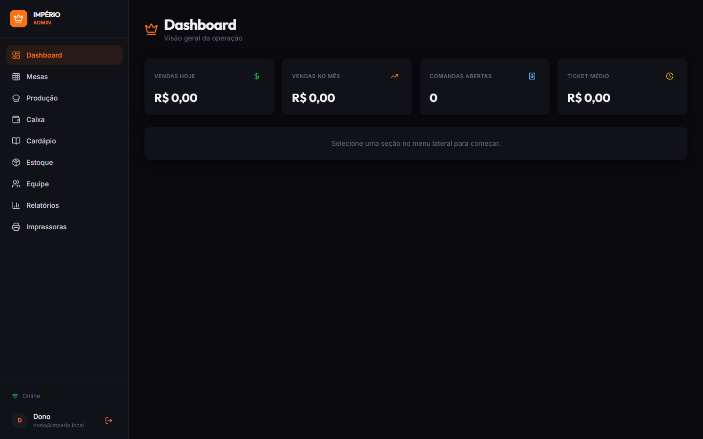

# 🥟 Império dos Pastéis · Sistema de Gestão & PDV

Sistema web full-stack para gestão completa de restaurante/pastelaria, com **Dashboard administrativo em tempo real**, controle de **mesas e comandas**, **fila de produção na cozinha (KDS)**, **PDV/caixa**, **cardápio com adicionais**, **estoque de insumos** e **fila de impressão térmica**.



## ✨ Funcionalidades

- **Dashboard Executivo:** faturamento do dia e do mês, ticket médio, comandas abertas, mesas ocupadas e pedidos em produção.
- **Mesas & Comandas:** abertura, acompanhamento de consumo em tempo real, adicionais por produto e fechamento de conta com múltiplos meios de pagamento.
- **Produção (KDS):** fila de preparo integrada entre atendimento e cozinha com controle de status.
- **Cardápio & Estoque:** gestão de categorias, produtos, adicionais, insumos e movimentações de entrada/saída.
- **Caixa, Equipe & Impressoras:** controle de abertura/fechamento de caixa, logs do sistema e fila de impressão térmica com testes.

## 🧱 Arquitetura (Web, APIs & SQL)

- **Front-end Web:** `React 19`, `TypeScript`, `TanStack Start`, `TanStack Router`, `Tailwind CSS v4`, `Radix UI` / `shadcn/ui`, `Lucide Icons`
- **Back-end & APIs:** Server Functions (SSR/RPC), consumo via API REST e atualizações em tempo real
- **Banco de Dados SQL:** PostgreSQL com migrations versionadas cobrindo **20 tabelas**:
  `usuarios`, `categorias`, `produtos`, `adicionais`, `produto_adicionais_config`, `mesas`, `caixas`, `comandas`, `comanda_itens`, `comanda_item_adicionais`, `pedidos_producao`, `pedido_itens`, `pagamentos`, `impressoras`, `fila_impressao`, `testes_impressora`, `estoque_movimentacoes`, `insumos`, `insumo_movimentacoes`, `logs_sistema`.

## 🚀 Executando localmente

```bash
bun install
bun run dev
```

Build de produção:

```bash
bun run build
```
